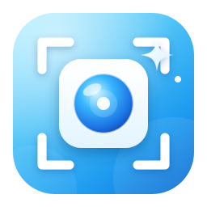

  

# SnapFree

A fast, native macOS screenshot and screen-recording app built with SwiftUI and ScreenCaptureKit.

## Download

**[⬇️ Download the latest version](https://github.com/sakshaaamm/SnapFree/releases/latest)**

1. Download the `SnapFree-x.x.zip` file from the release page
2. Unzip and drag **SnapFree.app** into your `/Applications` folder
3. On first launch, right-click SnapFree.app → **Open** to get past the macOS security prompt (this build is signed but not notarized)

See all releases on the [Releases page](https://github.com/sakshaaamm/SnapFree/releases).

## Features

- **Screenshots** — capture a selected area, window, or full screen
- **Scrolling capture** — scroll through long content and stitch it into one tall, seamless screenshot with pixel-exact alignment
- **Screen recording** — record the display with optional system audio, microphone, and a picture-in-picture face cam. Permissions are requested up front before recording starts
- **Built-in editor** — annotate captures with shapes, text, and drawing tools
- **OCR** — extract text from captures
- **History & Quick Access** — browse recent captures
- **Menu bar app** — lives in the status bar for quick access

## Requirements

- macOS 13.0 or later

## Permissions

SnapFree needs these macOS privacy permissions (requested on first use):

- **Screen Recording** — required for all capture and recording
- **Camera** — only if Face Cam is enabled
- **Microphone** — only if microphone recording is enabled

## Tech

- SwiftUI + AppKit
- ScreenCaptureKit (`SCStream`, `SCScreenshotManager`)
- AVFoundation (`AVAssetWriter`, `AVCaptureSession`)

## License

See [LICENSE](LICENSE).
